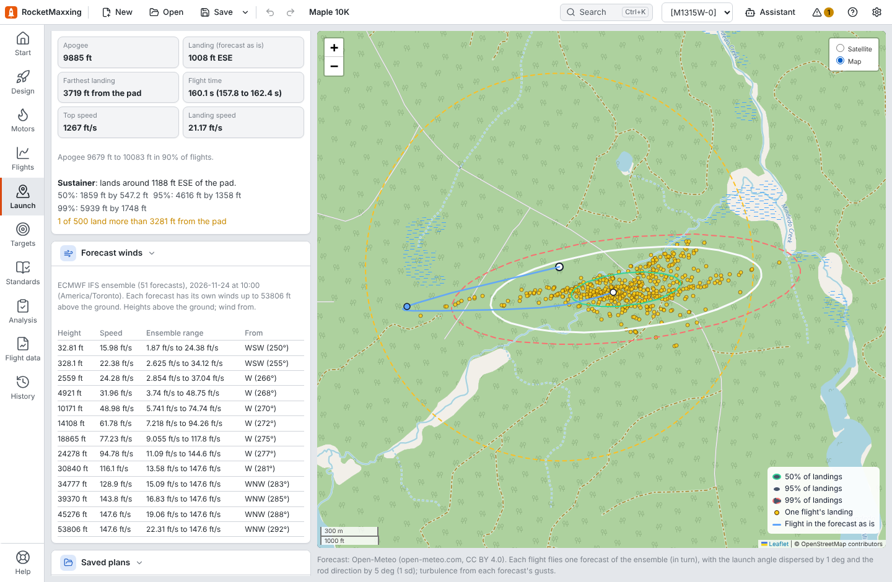

# RocketMaxxing

A desktop app for designing, simulating and checking competition rockets, on [OpenRocket](https://openrocket.info)'s
own physics. Design the rocket in 3-D, see the competition rules re-checked after every edit, run 54 engineering
analyses (recovery loads, fin flutter, shear pins, ejection charges, load diagrams, parachute sizing and more) and
plan launch day from the ensemble forecast, without writing code or keeping spreadsheets.

Free and open source, for Mac, Windows and Linux. It works offline, needs no account, and opens and saves ordinary
OpenRocket `.ork` files. Built for student competition teams and amateur rocketeers, and set up for **Launch Canada
2027** out of the box.

## What you can do

Each item links to a worked example on the [Examples page](docs/EXAMPLES.md), where one made-up 10,000 ft rocket goes
from a blank page to launch day with real output at every step.

- **Design in 3-D.** The parts list, the rocket with its CG and CP, and the selected part's properties side by side.
  Drag parts along the rocket and they line up with their neighbours. Add a whole avionics bay in one go, and
  **connectors** (eyebolts, U-bolts, eye nuts, quick links, swivels and shackles) in real sizes and masses. The
  exploded view pulls the rocket apart, with the parachutes opening on their lines. You can also add decals, make
  photo-studio pictures, and print full-size templates for the fins, rings and bulkheads.
  [Examples: Design](docs/EXAMPLES.md#design)
- **Rules checked as you go.** The Launch Canada rules are checked again after every edit, and each check cites its
  rule. The team's targets show their margins, and the team's standards (safety factors, materials, launch site) feed
  every check. [Examples: Flight and rules](docs/EXAMPLES.md#flight-and-rules)
- **Motors.** OpenRocket's motor database works offline, set up one flight configuration at a time. Import motor
  files, or make your own motor from static-fire data. Custom motors are kept with the designs, so a design keeps
  its motor.
- **Flights.** Run OpenRocket simulations and plot them with your own axes and units, zooming with a drag box. Compare
  flights, and turn a flight into a video. Above Mach 0.8, use a sharper high-speed drag model or an imported RASAero
  II table, with the same flight on OpenRocket's own drag drawn beside it.
- **Recovery.** Size the parachutes, and get the opening loads, shear pins, ejection charges, bay fit and landing
  dispersion (Monte Carlo, with a map for Google Earth). [Examples: Recovery](docs/EXAMPLES.md#recovery)
- **Structures.** Fin flutter, fin stress in FEA (CalculiX), the loads at each joint, heating, pressure vessels, and
  **load diagrams**: shear and bending moment at max q. Load diagrams use the University of Toronto Aerospace Team's
  load calculation ([`Load_calculations.py`](https://github.com/ArthurJWH/UTAT-Rocketry), by Fred Chun, edited by Nat
  Espinosa, Alexander Boldis and Nadim Hatoum). [Examples: Structures and CFD](docs/EXAMPLES.md#structures-and-cfd)
- **Launch day.** The **Launch** page flies the rocket through every forecast of the ECMWF (51) or NOAA (31) ensemble
  and draws the areas holding 50, 95 and 99% of the landings over satellite imagery of the site. The map is kept on
  your computer, so it still shows at the field without internet. Also: the flight card, rail-button placement and
  altimeter settings. [Examples: Launch day](docs/EXAMPLES.md#launch-day)
- **After the flight.** Load the altimeter log and see it against the simulation, with the drag fitted to the measured
  apogee. Look back over years of the team's rockets and logs.
  [Examples: Team history](docs/EXAMPLES.md#team-history)
- **Reviews.** Get the design review report, a list of what changed since PDR, and a full history with undo.
  [Examples: Reviews](docs/EXAMPLES.md#reviews)
- **An optional assistant.** Claude or Codex can drive the same engine, by asking in plain words. Everything above
  works without it. [The assistant](docs/ROCKETMAXXING.md#the-assistant-optional)

## Download

Get the installer for your computer from the **[Releases page](https://github.com/TheCheng2005/RocketMaxxing/releases)**:

| Computer | File |
|---|---|
| Windows | `RocketMaxxing-<version>-windows-x64.msi` |
| Mac with Apple Silicon (M1 and later) | `RocketMaxxing-<version>-macos-apple-silicon.dmg` |
| Mac with Intel | `RocketMaxxing-<version>-macos-intel.dmg` |
| Linux (Debian, Ubuntu) | `RocketMaxxing-<version>-linux-x64.deb` |

Java and everything else it needs come inside. The installers are not signed yet, so the first launch needs one extra
click: on a Mac, **System Settings > Privacy & Security > Open Anyway**; on Windows, **More info > Run anyway**. Step by
step: [Install](docs/ROCKETMAXXING.md#install).

## Where to go

| I want to... | Go to |
|---|---|
| Learn the app: every page, the analyses, the optional assistant | **[The RocketMaxxing guide](docs/ROCKETMAXXING.md)** |
| See what to ask and what comes back, from a blank page to launch day | **[Examples: the Maple 10K](docs/EXAMPLES.md)** |
| See it on a real rocket, checked against the log of its flight | [Worked example: NDRT 2020](docs/WORKED_EXAMPLE.md) |
| Use the engine from Claude or Codex instead (MCP server) | [RocketMaxxing for AI assistants](docs/MCP.md) |
| Know how a number is worked out, and its limits | [Technical reference](docs/REFERENCE.md) |
| See what changed in each version | [Releases](https://github.com/TheCheng2005/RocketMaxxing/releases) |
| Report a wrong number or a bug, or ask for something | [Issues](https://github.com/TheCheng2005/RocketMaxxing/issues/new/choose) |
| Build it from source or contribute | [Running from source](docs/ROCKETMAXXING.md#running-from-source) · [CONTRIBUTING.md](CONTRIBUTING.md) |

Every number is an engineering estimate from OpenRocket and standard calculations. It does **not** replace ground
tests, flight tests, your mentors or the range safety officer.

## License

GPL-3.0-or-later, like OpenRocket. See [LICENSE](LICENSE). The third-party software inside the app and its licences
are listed in Help > About.
