# Examples: what you ask, what you get

One rocket, from a blank page to launch day. Each step shows what a team member types, what Claude answers, and the
numbers and plots behind the answer. **Everything below is real output from the server** (OpenRocket 24.12), generated
by [`scripts/make_examples.py`](../scripts/make_examples.py); the one-line answers are written from those numbers.
Units follow the team setting (here metric with imperial in brackets). In Claude Desktop the plots and drawings
appear right in the chat, and long runs (optimizers, Monte Carlo) show their progress and can be stopped. Not sure what
to ask? Ask Claude what it can do: it also offers related things as you work.

Using [RocketMaxxing](ROCKETMAXXING.md), the desktop app? Nearly every step below is an analysis on its Analysis page
too, and the rest are on its Design, Flights and Launch pages: open the same design and do them there, no assistant
needed.

The Maple 10K is a made-up rocket. For a real one, checked against the log of its flight, see the
[worked example](WORKED_EXAMPLE.md).

**Steps:** [Design](#design) · [Recovery](#recovery) · [Flight and rules](#flight-and-rules) ·
[Design studies](#design-studies) · [Structures and CFD](#structures-and-cfd) · [Build](#build) · [Reviews](#reviews) ·
[Launch day](#launch-day) · [Show it off](#show-it-off) · [After the flight](#after-the-flight) ·
[Team history](#team-history) · [Electronics](#electronics) · [Parachutes and product links](#parachutes-and-product-links) ·
[Explore it in the chat](#explore-it-in-the-chat)

The rocket: *Maple 10K*, a 4 in fiberglass, dual-deploy, single-stage rocket for the 10,000 ft category of Launch
Canada 2027. Try it yourself: open [`examples/maple-10k-pdr.ork`](examples/maple-10k-pdr.ork) (the early version, before
step 3) or [`examples/maple-10k.ork`](examples/maple-10k.ork) (the finished design) and ask the same questions.

## Design

### 1. "Design a 4 inch fiberglass rocket with a 75 mm motor mount, dual deploy: 18 in drogue at apogee, 60 in main at 1000 ft. 18 in ogive nose, 64 in of airframe, four trapezoidal fins."

<sub>Tools Claude uses: `open_design`, `add_component`, `set_deployment`</sub>

Claude builds the rocket part by part in OpenRocket, inside as well as out: nose bulkhead, motor mount with three centering rings, rail buttons, both parachutes (with realistic packed sizes) and their shock cords. It opens in the OpenRocket app too.

### 2. "Lay out the avionics bay between the two airframes: two independent altimeters, a GPS tracker, and the ejection charges."

<sub>Tools Claude uses: `add_avionics_bay`</sub>

> Av-bay: 25.4 mm (1 in) switch band, 304.8 mm (12 in) coupler between Upper airframe and Lower airframe: 2 independent altimeter circuits (each: altimeter + own battery + own physical switch), GPS tracker on its own battery in the nose; main primary + backup on the forward bulkhead, drogue primary + backup on the aft bulkhead. Bay mass 893.9 g (1.971 lb). Static ports: bay volume 124 in3: 4 ports of 0.139 in (3.5 mm) evenly around the switch band (same area as 1.2 x 1/4 in).

<details><summary>Bay layout</summary>

| Part | Position | Mass |
|---|---|---|
| Main charge (primary) | 901.7 mm from the nose tip | 12 g |
| Main charge (backup) | 901.7 mm from the nose tip | 12 g |
| U-bolt (main harness) | 906.8 mm from the nose tip | 30 g |
| Sled, threaded rods and nuts | 939.3 mm from the nose tip | 120 g |
| 9 V battery (primary altimeter) | 943.5 mm from the nose tip | 46 g |
| Primary altimeter | 995.1 mm from the nose tip | 25 g |
| Screw switch (primary altimeter) | 1067 mm from the nose tip | 10 g |
| Screw switch (backup altimeter) | 1067 mm from the nose tip | 10 g |
| Backup altimeter | 1079 mm from the nose tip | 25 g |
| 9 V battery (backup altimeter) | 1168 mm from the nose tip | 46 g |
| Drogue charge (primary) | 1232 mm from the nose tip | 12 g |
| Drogue charge (backup) | 1232 mm from the nose tip | 12 g |
| U-bolt (drogue harness) | 1232 mm from the nose tip | 30 g |

</details>

> ⚠️ not enough room in Upper airframe: the charges, shock cord and parachute need 520.1 mm (20.48 in) from the av-bay but only 508 mm (20 in) is free before the nose shoulder. Lengthen the airframe, shorten the coupler, or use a smaller-packing parachute.

> ⚠️ not enough room in Lower airframe: the charges, shock cord and parachute need 298 mm (11.73 in) from the av-bay but only 254 mm (10 in) is free before the motor mount. Lengthen the airframe, shorten the coupler, or use a smaller-packing parachute.

*"Lengthen the upper airframe to 26 in and the lower airframe to 43 in."* The bay packs the parachutes against itself and the motor mount, fins and rail buttons are positioned from the aft end, so everything keeps its place and the parachutes get the room.

The layout follows the Launch Canada electronics edicts: one altimeter per circuit, each with its own battery and physical switch; the tracker on its own battery; charges on the bulkhead facing the bay they open. Masses are typical defaults: give Claude your actual altimeters, batteries and tracker (name, mass, length) and it uses them.

### 3. "Which motor gets us closest to 10,000 ft?"

<sub>Tools Claude uses: `rank_motors`, `set_motor`</sub>

> **AeroTech L1250DM**, 10,050 ft predicted. 68 distinct motors fit (diameter, length + 50 mm (1.969 in) overhang, filters); 60 simulated; 55 meet the rules: each one was flown in the simulation, not just looked up, and motors that break a rule (rail exit speed, thrust-to-weight, stability) are ranked last.

| Motor | Impulse | Apogee (vs 10,000 ft) | Rail exit | Max Mach | Min stability | Meets rules |
|---|---|---|---|---|---|---|
| AeroTech L1250DM | L, 4400 Ns (989.2 lbf-s) | 3063 m (10050 ft) (+15.34 m (50.31 ft)) | 39.39 m/s (129.2 ft/s) | 1.133 | 2.08 cal | yes |
| AeroTech L1170FJ | L, 4214 Ns (947.4 lbf-s) | 2969 m (9741 ft) (-79.07 m (-259.4 ft)) | 40.07 m/s (131.5 ft/s) | 1.172 | 1.919 cal | yes |
| AeroTech L1940X | L, 4317 Ns (970.5 lbf-s) | 3143 m (10313 ft) (+95.31 m (312.7 ft)) | 55.02 m/s (180.5 ft/s) | 1.409 | 2.236 cal | yes |
| Cesaroni Technology 4263L1350-P | L, 4280 Ns (962.2 lbf-s) | 3154 m (10348 ft) (+106 m (347.6 ft)) | 45.17 m/s (148.2 ft/s) | 1.341 | 2.109 cal | yes |
| Cesaroni Technology 3757L800-P | L, 3723 Ns (836.9 lbf-s) | 2928 m (9606 ft) (-120 m (-393.6 ft)) | 38.11 m/s (125 ft/s) | 1.031 | 2.045 cal | yes |
| AeroTech L1390G | L, 3946 Ns (887.2 lbf-s) | 2908 m (9540 ft) (-140.2 m (-460 ft)) | 44.4 m/s (145.7 ft/s) | 1.224 | 2.08 cal | yes |

### 4. "It goes supersonic. Will our 1/8 in fins flutter?"

<sub>Tools Claude uses: `fin_flutter`</sub>

> **FAIL.** At 382.7 m/s (1255 ft/s) (Mach 1.133) and 640.6 m the estimated flutter speed is only 163 m/s: margin 0.4259 against the team's required 1.5. Fins at least **7.407 mm (0.2916 in)** thick, a stiffer material or a lower aspect ratio fix it.

### 5. "We'll make the fins from 1/4 in quasi-isotropic carbon. Our coupon test gave a shear modulus of 16 GPa: save that to our standards and check again."

<sub>Tools Claude uses: `update_standards`, `edit_components`, `fin_flutter`</sub>

> **PASS**, margin 2.973 (shear modulus 16 GPa from your standards file, so every later check and the whole team use the measured value).

### 6. "It has to meet the stability rules (also in 30 km/h wind): add the nose weight it needs, then optimize the fin shape for the least drag while staying clear of flutter (span no more than 8 in), and pick the motor again."

<sub>Tools Claude uses: `ballast`, `add_component`, `optimize_fins`, `rank_motors`, `fin_flutter`</sub>

> **293 g of nose ballast**, then the whole fin shape at once: root chord **130.3 mm**, tip chord **97.72 mm**, span **177.5 mm**, sweep **25.91 mm** (meets every constraint; launch mass +39.97 g (1.41 oz)): stability 2.215 cal to 5.168 cal in flight, flutter margin 2.889. Best motor now: **AeroTech M1315W**, 9,829 ft, Mach 1.173. Final flutter check: **PASS**, margin 2.45.


<sub>Only buildable fins are tried: tip chord at least 0.5 in, no tip trailing edge behind the root (it would take the landing), leading-edge sweep at most 65 deg, span at most 8 in as asked. Why ballast: with the real avionics bay modelled, the electronics sit further aft than a single lump would, so the CG moves back. Limits used: minStability 2.189 cal = max(1.5 cal, 10% of body length at L:D 21.89); maxStability 6 cal (over-stable); flutter margin ≥ 1.5 from the team standards.</sub>

### 7. "Show me the rocket."

<sub>Tools Claude uses: `draw_rocket`</sub>

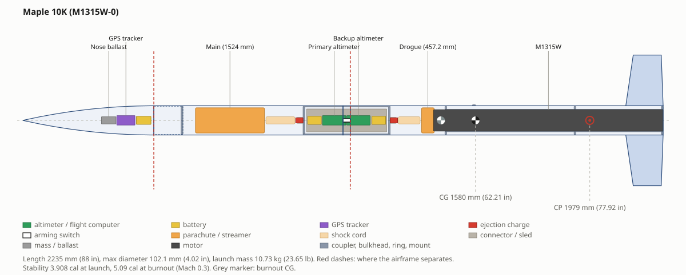

A cut-away from the OpenRocket model itself: every part is drawn where it is, electronics coloured by role, and the red dashes show where the rocket separates (main at the nose, drogue below the avionics bay).

88 in long, 10.73 kg (23.65 lb) on the pad, stability 3.908 cal at launch and 5.09 cal at burnout.

### 8. "What if we used 1/8 in carbon for the fins to save weight?"

<sub>Tools Claude uses: `edit_components`, `fin_flutter`</sub>

> Claude makes the change and checks it: flutter **FAIL**, margin 0.7563 (flutter speed / airspeed; the team wants 1.5). Thinner fins would need 5.012 mm to be safe.

### 9. "Undo that."

<sub>Tools Claude uses: `undo`, `history`</sub>

> Undone: *edit_components* (the thickness change). Every edit in the session can be undone or redone, newest first; `history` lists them (21 so far in this session). Nothing touches the `.ork` file until you ask Claude to save.

## Recovery

### 10. "What main do we need to land at 20 ft/s? And a drogue for about 85 ft/s."

<sub>Tools Claude uses: `size_parachute`, `edit_components`</sub>

> The descending mass is 7.276 kg (16.04 lb), so the main needs a drag area of 3.135 m2 (33.74 ft2) (a 2234 mm flat canopy at Cd 0.8). Parachutes from OpenRocket's catalogue that do it:

| Parachute | Diameter | Cd | Descent | Packed size | Mass |
|---|---|---|---|---|---|
| Rocketman DG-07 | 2134 mm (84 in) | 0.85 | 6.191 m/s (20.31 ft/s) | 101.6 mm (4 in) dia x 185.4 mm (7.3 in) = 1503 cm3 (91.73 in3) | 442.8 g (15.62 oz) |
| Rocketman LA-07 | 2134 mm (84 in) | 0.85 | 6.191 m/s (20.31 ft/s) | 76.2 mm (3 in) dia x 188 mm (7.4 in) = 857.2 cm3 (52.31 in3) | 252.3 g (8.9 oz) |
| Rocketman EL-060 | 1524 mm (60 in) | 1.6 | 6.318 m/s (20.73 ft/s) | 101.6 mm (4 in) dia x 101.9 mm (4.01 in) = 825.8 cm3 (50.39 in3) | 280.7 g (9.9 oz) |
| b2 Rocketry Company CL-60 | 1524 mm (60 in) | 1.89 | 5.813 m/s (19.07 ft/s) | 99.06 mm (3.9 in) dia x 279.4 mm (11 in) = 2153 cm3 (131.4 in3) | 283.5 g (10 oz) |

*"Use the Rocketman DG-07 and a 21 in drogue."*

### 11. "What loads do the chutes see when they open, and how many 4-40 nylon shear pins do we need?"

<sub>Tools Claude uses: `recovery_analysis`, `ejection_charge`</sub>

| device | opens at | design load | harness rating | descent |
|---|---|---|---|---|
| Drogue | 2998 m, 19.95 m/s | 72.54 N (16.31 lbf) | 145.1 N | 26.9 m/s (88.27 ft/s) |
| Main | 302.8 m, 26.14 m/s | 1730 N (388.8 lbf) | 3459 N | 6.081 m/s (19.95 ft/s) |

> Shear pins on the main bay: **3 x 4-40 nylon** (they must hold while the drogue opens). Black powder for a 4 × 12 in bay at 15 psi: **1.75 g** primary, 2.187 g backup. The harness rating is twice the opening load, for shock cord, quick links and eye bolts.

### 12. "Add the connectors: a forged 1/4 in eyebolt on the nose bulkhead and the motor's forward closure, 1/4 in quick links at both ends of each shock cord and a swivel on each chute."

<sub>Tools Claude uses: `add_component`</sub>

> 8 connectors, 196 g in all, each where it hangs (the bay's U-bolts came with it in step 2). The harnesses need a rating of 778 lbf, so the swivels are the 1,000 lb ones.

| Connector | Joins |
|---|---|
| Eyebolt 1/4"-20, forged | on the nose bulkhead |
| Quick link 1/4" (6 mm) | main harness to the nose |
| Swivel, ball-bearing (1,000 lb) | main to its harness |
| Quick link 1/4" (6 mm) | main harness to the bay |
| Quick link 1/4" (6 mm) | drogue harness to the bay |
| Swivel, ball-bearing (1,000 lb) | drogue to its harness |
| Quick link 1/4" (6 mm) | drogue harness to the motor |
| Eyebolt 1/4"-20, forged | in the motor's forward closure |

Connectors are mass components marked as recovery hardware, so they count in the mass, CG and descent rates, and the 3-D views draw each one as what it is. In RocketMaxxing they are one click away: **Add part → Connectors** lists eyebolts (#10-24 to 1/2"), U-bolts, eye nuts, quick links (3.5 to 10 mm), swivels and shackles with real masses, in grams or ounces.

## Flight and rules

### 13. "Does it pass Launch Canada?"

<sub>Tools Claude uses: `check_requirements`</sub>

> **No failures; 5 warning(s).** Every check cites its rule, and there is a checklist of 15 things to verify by hand (electronics, radio, structures, operations).

|  | Check | Value | Rule |
|---|---|---|---|
| WARN | Within the models' range | OpenRocket warns: Body calculations may not be entirely accurate at supersonic speeds. |  |
| WARN | Launch site altitude | 0 m (0 ft) used by this simulation |  |
| WARN | Ascent stability (maximum, over-stability) | 5.818 cal | R10.3.1, R10.4.1 |
| WARN | Ascent stability in 8.333 m/s (27.34 ft/s) wind (maximum, over-stability) | 5.817 cal | R10.3.1, R10.4.1 |
| WARN | Maximum Mach number | 1.156 |  |
| PASS | Simulated launch angle | 6 deg | R10.1.1 |
| PASS | Rail departure velocity | 41.48 m/s (136.1 ft/s) | R10.2.1 |
| PASS | Thrust-to-weight at liftoff (avg thrust / liftoff weight) | 10.64 | R10.2.2, R3.1.2, R3.1.3; 2027 Edicts (Advanced Specific) |
| PASS | Ascent stability (minimum, rail exit to apogee while airspeed > 100 ft/s) | 3.636 cal at t=0.345 s, Mach 0.1227; angle of attack 3.1 deg there (wind / rail exit): OpenRocket's CP moves forward at high angle of attack. Zero-AoA margin: 4.123 cal | R10.3.1, R10.4.1 |
| PASS | Ascent stability in 8.333 m/s (27.34 ft/s) wind (minimum, rail exit to apogee while airspeed > 100 ft/s) | 2.525 cal at t=0.345 s, Mach 0.1275; angle of attack 12.26 deg there (wind / rail exit): OpenRocket's CP moves forward at high angle of attack. Zero-AoA margin: 4.124 cal | R10.3.1, R10.4.1 |
| PASS | Fin flutter margin (Fins, Carbon fiber) | 2.483 at 931.4 m (3056 ft), 389.1 m/s (1276 ft/s) | Team standard |
| PASS | Length-to-diameter ratio | 21.89 | 2027 Edicts, Stability: L:D Ratio |

### 14. "Simulate the flight and plot it."

<sub>Tools Claude uses: `run_simulation`</sub>

> Apogee **3002 m (9849 ft)** at 20.65 s. Top speed 388.9 m/s (1276 ft/s) (Mach 1.156), 15.04 G peak, 41.48 m/s (136.1 ft/s) off the rail.

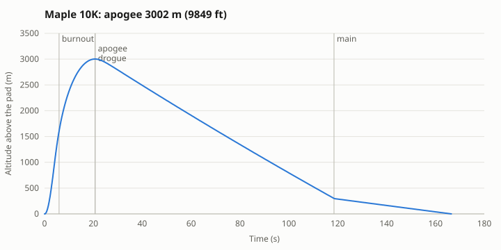

### 15. "Where will it land in a 15 km/h west wind? Include our build and motor uncertainty, and give us a map for Google Earth."

<sub>Tools Claude uses: `monte_carlo`</sub>

> Over 200 simulated flights the median landing is 225.6 m (740.1 ft) from the pad and 95% land within 519.8 m (1705 ft); the landings centre 623 ft west of the pad (the rail is tilted into the wind, so it flies upwind and drifts back under the drogue). Apogee 2984 m (9789 ft) ± 199.2 m (653.5 ft).

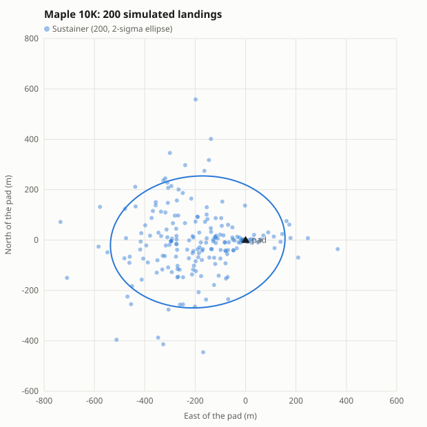

[`landing.kml`](examples/landing.kml) puts the pad, every landing and the ellipse on the map in Google Earth (desktop, web or phone), so the recovery team and the RSO see the fields, roads and trees it covers.

Claude also reports what drives the spread (correlation of each uncertain input with the result), so the team knows what to measure more carefully:

| Uncertain input | Apogee | Min stability | Landing distance |
|---|---|---|---|
| windSpeed | -0.1409 | -0.9661 | -0.7438 |
| launchAngle | -0.1528 | -0.005575 | 0.3807 |
| structureMass | -0.05467 | 0.1312 | 0.1094 |
| airframeDrag | -0.9219 | 0.04424 | -0.1842 |
| motorThrust | 0.3231 | 0.07166 | -0.02155 |
| parachuteCd | -0.03611 | 0.03 | -0.109 |

<sub>Correlation from -1 to 1: the closer to ±1, the more that input drives the result.</sub>

## Design studies

### 16. "Would a different nose cone or fin shape fly higher?"

<sub>Tools Claude uses: `compare_shapes`</sub>

> Best that keeps the stability: **Von Karman (Haack LD) nose with airfoil fin edges: 3721 m (12209 ft) (+23.97% vs current)**. Every nose profile and fin edge was flown; CD at the design Mach (1.156) shows where the gain comes from.

| Nose | Fin edges | Apogee | vs current | CD | Min stability |
|---|---|---|---|---|---|
| Von Karman (Haack LD) | airfoil | 3721 m (12209 ft) | 23.97% | 1.072 | 3.702 cal |
| tangent ogive (current) | airfoil | 3717 m (12195 ft) | 23.82% | 1.092 | 3.698 cal |
| tangent ogive (current) | rounded | 3585 m (11762 ft) | 19.43% | 1.152 | 3.642 cal |
| Von Karman (Haack LD) | square (current) | 3018 m (9901 ft) | 0.5285% | 1.338 | 3.64 cal |
| 1/2 power | square (current) | 3017 m (9897 ft) | 0.4901% | 1.336 | 3.651 cal |
| LV-Haack | square (current) | 3009 m (9872 ft) | 0.242% | 1.352 | 3.645 cal |
| 3/4 power | square (current) | 3004 m (9856 ft) | 0.07587% | 1.359 | 3.632 cal |
| parabolic | square (current) | 3004 m (9855 ft) | 0.06569% | 1.365 | 3.636 cal |

<details><summary>Claude's shape guidance (from the tool)</summary>

- Subsonic (< Mach 0.8): skin friction dominates; nose shape changes apogee by ~1-3%. Tangent ogive or elliptical are easy to make and near-optimal; a smooth finish and filled fin joints matter more.
- Transonic / supersonic: theory favours Von Karman / LV-Haack and a longer nose (5-6 calibers) for wave drag, and blunt shapes (elliptical, 1/2 power) lose. OpenRocket uses empirical per-shape curves, so at modest fineness a tangent ogive can rank equal or better in this table: trust the table for this vehicle, and the theory only as a tie-breaker.
- Fin edges: airfoiled or beveled edges reduce fin pressure drag, most at high speed; they also lower the fin's thickness where it is thin, so re-check fin_flutter. Swept, clipped-delta planforms suit supersonic flight.
- OpenRocket's nose and fin pressure-drag models are empirical and least accurate transonic; confirm close calls with RASAero (import_aero_table) or CFD before committing tooling.

</details>

## Structures and CFD

### 17. "Check the fins in FEA: our quasi-isotropic laminate has E = 45 GPa and Poisson's ratio 0.3. And give us the joint loads for the airframe FEA."

<sub>Tools Claude uses: `fin_fea`, `structural_loads`</sub>

> **PASS**, margin of safety 8.699 with the team's safety factor of 2. Design load 209.2 N (47.04 lbf) (limit load; the most loaded fin), from the crosswind gust at max q at t=3.943 s, Mach 1.155, q 84.71 kPa (12.29 psi), angle of attack 1.227 deg. Tip deflection 1.099 mm; peak stress 23.2 MPa. Natural frequencies: 183.8 Hz (1st bending), 643.7 Hz (1st torsion), 1074 Hz (2nd bending).

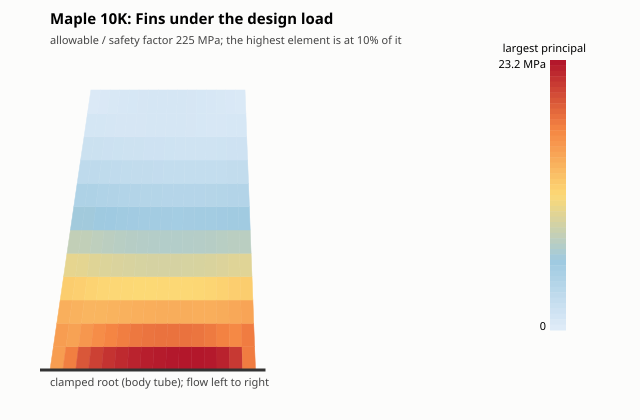

Claude writes a CalculiX model of the fin (8-node shells, clamped root, the flight load) and runs it when CalculiX is installed. The input deck is kept, so a team member can refine it in PrePoMax or Abaqus. The model was checked against cantilever plate theory: deflection, root stress and first frequency agree within 0.2%. The stress peaks at the root, most at its corners, where the real fin's fillet or tab spreads the load.

Joint loads for the airframe: 3 joints, the highest wall stress at Switch band / Lower airframe: 4539 kPa (658.3 psi); the load cases (axial force, bending moments, the flight time, Mach and angle of attack of each) go to a CSV for the tube and coupler FEA.

### 18. "Draw the shear and bending moment diagrams at max q, the way our UTAT load script does."

<sub>Tools Claude uses: `load_diagrams`</sub>

> The largest bending moment is **576.4 N·m**, 1827 mm from the nose tip, and the largest shear 1705 N, both where the fins take the lift. That is at max q: 84.71 kPa at Mach 1.155, 3.943 s into the flight, held at 5 deg angle of attack.

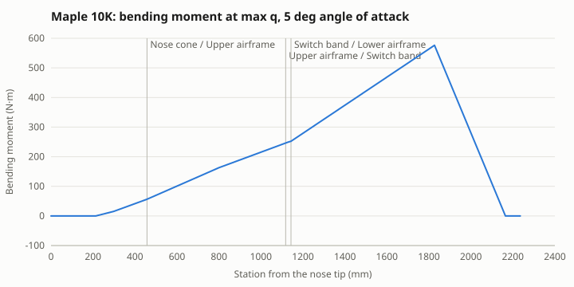

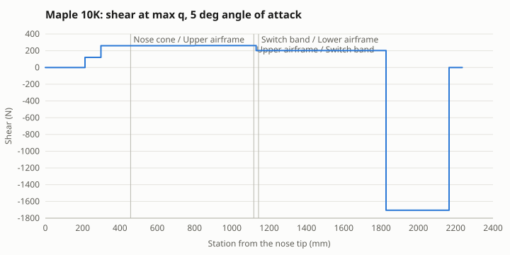

| Joint | Station | Shear | Bending moment | Axial force |
|---|---|---|---|---|
| Nose cone / Upper airframe | 457.2 mm | 260.1 N | 56.54 N·m | -100.2 N |
| Upper airframe / Switch band | 1118 mm | 261.7 N | 246.2 N·m | -217.3 N |
| Switch band / Lower airframe | 1143 mm | 203.1 N | 252.1 N·m | -167.6 N |

This is the University of Toronto Aerospace Team's load calculation ([`Load_calculations.py`](https://github.com/ArthurJWH/UTAT-Rocketry), by Fred Chun, edited by Nat Espinosa, Alexander Boldis and Nadim Hatoum): the rocket as a rigid body at max q, each lifting part's lift at its centre of pressure and every part's inertia answering it. Here the parts, masses, lift slopes and CPs come from the design; give Claude the team's own parts, conditions and AeroLab files instead and it runs them as the script does (the two agree to a millionth). In RocketMaxxing it is **Load diagrams** on the Analysis page, with the four plots.

### 19. "Export it for CFD, and tell us which cases to run."

<sub>Tools Claude uses: `export_geometry`</sub>

> The rocket as STL (9840 triangles, mm, one region per part so the solver reports the force on each), the fin cutting pattern as DXF for the waterjet or laser, and a run matrix taken from the simulated flight: each Mach number at the altitude where the rocket reaches it. When the CFD results are in, `import_aero_table` reads them back and every later simulation and rule check uses them.


| Case | Mach | Altitude | Velocity | Reynolds | OpenRocket CD |
|---|---|---|---|---|---|
| M0.10 | 0.1 | 4.053 m (13.3 ft) | 34.04 m/s (111.7 ft/s) | 5.21e+06 | 1.056 |
| M0.30 | 0.3 | 36.59 m (120.1 ft) | 102.1 m/s (334.9 ft/s) | 1.56e+07 | 1.079 |
| M0.50 | 0.5 | 106.9 m (350.7 ft) | 170 m/s (557.7 ft/s) | 2.58e+07 | 1.124 |
| M0.70 | 0.7 | 203.8 m (668.7 ft) | 237.7 m/s (779.9 ft/s) | 3.58e+07 | 1.192 |
| M0.80 | 0.8 | 275.2 m (902.8 ft) | 271.4 m/s (890.6 ft/s) | 4.07e+07 | 1.235 |
| M0.90 | 0.9 | 363.6 m (1193 ft) | 305.1 m/s (1001 ft/s) | 4.54e+07 | 1.285 |
| M0.95 | 0.95 | 426.3 m (1399 ft) | 321.8 m/s (1056 ft/s) | 4.76e+07 | 1.306 |
| M1.00 | 1 | 488.5 m (1603 ft) | 338.5 m/s (1110 ft/s) | 4.98e+07 | 1.329 |
| M1.05 | 1.05 | 569 m (1867 ft) | 355.1 m/s (1165 ft/s) | 5.20e+07 | 1.376 |
| M1.10 | 1.1 | 688.5 m (2259 ft) | 371.4 m/s (1219 ft/s) | 5.38e+07 | 1.38 |
| M1.20 | 1.2 | 966.3 m (3170 ft) | 403.9 m/s (1325 ft/s) | 5.73e+07 | 1.33 |
| max_q | 1.155 | 931.4 m (3056 ft) | 389.1 m/s (1276 ft/s) | 5.53e+07 | 1.359 |

## Build

### 20. "We weighed the parts we've built. Here is our weigh-in sheet; how does it compare with the model? Our launch mass target is 12 kg."

<sub>Tools Claude uses: `mass_budget`</sub>

<details><summary>Weigh-in sheet (sample numbers)</summary>

```csv
part,mass (g),status,section,parent
Nose cone,491,measured,no,
Upper airframe,830,measured,no,
Lower airframe,1398,measured,no,
Fins,1052,measured,no,
Av-bay coupler,358,measured,no,
Fin fillets and tip-to-tip epoxy,140,measured,no,Lower airframe
Paint and primer,90,estimated,no,Upper airframe
```

</details>

| Part | Weigh-in | Model | Difference |  |
|---|---|---|---|---|
| Fins | 1.052 kg (2.319 lb) (measured) | 915 g (2.017 lb) | +137 g (4.831 oz) (+15%) | CHECK |
| Lower airframe | 1.398 kg (3.082 lb) (measured) | 1.271 kg (2.802 lb) | +127.1 g (4.482 oz) (+10%) | ok |
| Upper airframe | 830 g (1.83 lb) (measured) | 768.5 g (1.694 lb) | +61.53 g (2.17 oz) (+8%) | ok |
| Nose cone | 491 g (1.082 lb) (measured) | 438.8 g (15.48 oz) | +52.17 g (1.84 oz) (+12%) | CHECK |
| Av-bay coupler | 358 g (12.63 oz) (measured) | 340.5 g (12.01 oz) | +17.49 g (0.617 oz) (+5%) | ok |
| Fin fillets and tip-to-tip epoxy | 140 g (4.938 oz) (measured) |  |  |  |
| Paint and primer | 90 g (3.175 oz) (estimated) |  |  |  |

> Projected launch mass **11.84 kg (26.11 lb)**, including 5.645 kg (12.44 lb) of motor and 10% contingency on everything not weighed yet: +156.7 g (5.526 oz) under the target of 12 kg. 2 part(s) differ from the model by more than 10% (flagged). The sheet leaves out 1.664 kg of parts the model has (heaviest: Nose ballast 293 g (10.34 oz), Main 242.8 g (8.564 oz), Motor mount 186.8 g (6.589 oz)), which stay at the model's values.

### 21. "Put the weigh-ins into the design."

<sub>Tools Claude uses: `mass_budget`</sub>

> Done: 7 changes (mass overrides on the weighed parts, the fillets and paint added as mass components). Launch mass 11.04 kg (24.34 lb) -> 11.67 kg (25.72 lb), CG 1562 mm (61.49 in) -> 1556 mm (61.24 in), stability 4.087 -> 4.149 cal. Every later step flies the rocket as built; `undo` takes it back in one step.

## Reviews

### 22. "Where do we stand? What's left before CDR?"

<sub>Tools Claude uses: `design_status`</sub>

> **In progress: 2 thing(s) to set up, 6 warning(s).** Launch Canada 2027: DTEG Revision 4 + LC 2027 DTEG and R&R Edicts (to become DTEG R5): No failures; 5 warning(s).

| Area | Status | Finding |
|---|---|---|
| Rules | WARN | Within the models' range: OpenRocket warns: Body calculations may not be entirely accurate at supersonic speeds. |
| Launch site | WARN | Launch site altitude: 0 m (0 ft) used by this simulation |
| Stability | WARN | Ascent stability (maximum, over-stability): 5.809 cal (R10.3.1, R10.4.1) |
| Stability | WARN | Ascent stability in 8.333 m/s (27.34 ft/s) wind (maximum, over-stability): 5.809 cal (R10.3.1, R10.4.1) |
| Rules | WARN | Maximum Mach number: 1.125 |
| Electronics | WARN | GPS tracker (1S LiPo 500 mAh): less than 30% to spare: a delay on the pad or a long search uses it up |
| Standards | TODO | The team standards were changed in this session but are not saved to a file, so the next session and the rest of the team will not have them. |
| File | TODO | Unsaved changes (30 edit(s) this session, undo available). |

Next steps, in order:

1. check_requirements for the details and rule reference.
2. update_standards launchSite.altitudeMsl (and weather_forecast on the day).
3. optimize_fins (smaller fins) or less nose ballast.
4. power_budget for the details.
5. update_standards with saveTo (e.g. openrocket-mcp.json), then commit the file.
6. save_design once the team agrees (history shows what changed).

### 23. "Make the design review package."

<sub>Tools Claude uses: `generate_report`</sub>

Claude writes a folder with `report.md` (requirement checks, vehicle, flight, stability, recovery, wind table, methods), the stability-vs-time plots Launch Canada asks for (DTEG R10.3.2), the drawing, the flight profile and a CSV of the flight data.

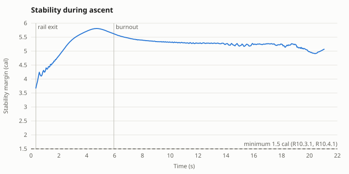

### 24. "What changed since the version we showed at PDR?"

<sub>Tools Claude uses: `compare_designs`</sub>

- launch mass: 9.978 kg (22 lb) -> 11.67 kg (25.72 lb) (+1.69 kg (3.726 lb) (+16.94%))
- static stability at launch: 2.66 cal -> 4.149 cal (+1.489 cal)
- apogee: 3063 m (10050 ft) -> 3009 m (9873 ft) (-54.11 m (177.5 ft) (-1.766%))
- max Mach: 1.133 -> 1.125 (-0.007699)
- rail exit velocity: 39.39 m/s (129.2 ft/s) -> 39.61 m/s (129.9 ft/s) (+0.2168 m/s (0.7111 ft/s) (+0.5503%))
- min stability in flight: 2.08 cal -> 3.676 cal (+1.596 cal)
- 9 rule check(s) changed status, 2 got worse
- 18 component(s) added, removed or edited

- **Nose cone (Nose Cone)**: massOverridden false -> true; overrideMass 438.8 g (15.48 oz) -> 491 g (1.082 lb)
- **Upper airframe (Body Tube)**: massOverridden false -> true; overrideMass 768.5 g (1.694 lb) -> 830 g (1.83 lb)
- **Main (Parachute)**: area 1.824 m2 (19.63 ft2) -> 3.575 m2 (38.48 ft2); cD 0.8 -> 0.85; diameter 1524 mm (60 in) -> 2134 mm (84 in)
- **Av-bay coupler (Tube Coupler)**: massOverridden false -> true; overrideMass 340.5 g (12.01 oz) -> 358 g (12.63 oz)

## Launch day

### 25. "We launch at 48.47, -81.33 on August 21 at 3 pm. What will the winds do, and make us the flight card."

<sub>Tools Claude uses: `weather_forecast`, `flight_card`</sub>

> Ground wind 6.75 m/s (22.15 ft/s) (24.3 km/h) from 250 deg, gusts 12 m/s (39.37 ft/s) (43.2 km/h) (mean wind within 30 km/h limit; gusts exceed it). Flown in the forecast winds aloft: apogee 3028 m (9935 ft), landing 126.3 m (414.5 ft) from the pad.

<sub>(A recorded forecast is used here so the page is reproducible; with internet access Claude fetches the live one from Open-Meteo.)</sub>

Winds aloft from the forecast, flown as a wind profile:

- 10 m (32.81 ft) AGL: 6.75 m/s (22.15 ft/s) from 250 deg
- 180 m (590.6 ft) AGL: 9.79 m/s (32.12 ft/s) from 255 deg
- 690 m (2264 ft) AGL: 5.65 m/s (18.54 ft/s) from 262.5 deg
- 2710 m (8891 ft) AGL: 9.02 m/s (29.59 ft/s) from 267.5 deg
- 6880 m (22572 ft) AGL: 15.97 m/s (52.4 ft/s) from 278 deg
- 11480 m (37664 ft) AGL: 23.63 m/s (77.53 ft/s) from 289.5 deg

From the one-page flight card (predictions, motor delay, deployment settings, drift in each wind, rule check and sign-off lines):

> **Predicted flight**
>
> | | |
> |---|---|
> | Apogee | 3028 m (9935 ft) |
> | Time to apogee | 21.02 s |
> | Max velocity | 385.6 m/s (1265 ft/s) |
> | Max Mach | 1.13 |
> | Max acceleration | 139.7 m/s2 (458.4 ft/s2) = 14.25 G |
> | Rail exit velocity | 39.59 m/s (129.9 ft/s) |
> | Thrust-to-weight | 12.51 |

### 26. "We could also fly the morning window. A week out, fly it through every forecast of the ensemble for 10 am: where could it land, and does it stay inside the 3 km recovery area?"

<sub>Tools Claude uses: `launch_planner`</sub>

> 95% of 300 flights land inside an area 638.6 m (2095 ft) by 247.3 m (811.5 ft), centred 306.3 m (1005 ft) ESE of the pad. None of the 300 flights land more than 3 km from the pad. Apogee 3020 m (2972 m to 3065 m in 90% of the flights); in the forecast as it stands it lands 287.6 m ESE.

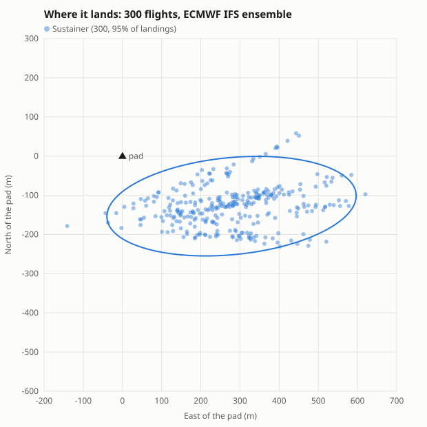

| Landings inside | Area |
|---|---|
| 50% | 318.6 m by 123.4 m |
| 95% | 638.6 m by 247.3 m |
| 99% | 846.1 m by 327.7 m |

Winds the forecasts agree on, and how far they spread:

| Height | Wind | Across the forecasts | From |
|---|---|---|---|
| 10 m | 4.5 m/s | 3.39 m/s to 5.48 m/s | WSW (250°) |
| 100 m | 6.3 m/s | 4.75 m/s to 7.68 m/s | WSW (255°) |
| 780 m | 6.84 m/s | 5.16 m/s to 8.34 m/s | W (266°) |
| 1500 m | 9 m/s | 6.79 m/s to 10.97 m/s | W (268°) |
| 3100 m | 13.8 m/s | 10.4 m/s to 16.82 m/s | W (270°) |
| 4300 m | 17.4 m/s | 13.12 m/s to 21.21 m/s | W (272°) |

Each flight flies one forecast of the ECMWF ensemble (51 forecasts with their own winds aloft, 15 days ahead; or NOAA's GEFS, 31 forecasts), with the launch angle and rod direction dispersed. The spread of the forecasts is the uncertainty in the weather itself, so the area shrinks as the day gets closer. In RocketMaxxing the **Launch** page draws the same areas over satellite imagery of the site, keeps the map for the field without internet, and saves each plan to compare as the day comes.

<sub>(A recorded ensemble of 11 forecasts keeps the page reproducible; with internet access Claude fetches all 51 from Open-Meteo.)</sub>

### 27. "Where should the rail buttons go to get the most out of the rail?"

<sub>Tools Claude uses: `rail_buttons`</sub>

> The aft button goes 15 mm above the aft end and the forward one 955.7 mm up, 940.7 mm apart. The rocket leaves the rail at 39.08 m/s instead of 38.95 m/s with today's layout. OpenRocket says 39.59 m/s because it counts the whole rail and ignores where the buttons are.

|  | Current | Recommended |
|---|---|---|
| Forward button | 660.4 mm (26 in) above the aft end (1575 mm (62 in) from the nose tip) (no backing: add a block) | 955.7 mm (37.62 in) above the aft end (1280 mm (50.38 in) from the nose tip) (over Av-bay coupler) |
| Aft button | 50.8 mm (2 in) above the aft end (2184 mm (86 in) from the nose tip) (no backing: add a block) | 15 mm (0.5906 in) above the aft end (2220 mm (87.41 in) from the nose tip) (no backing: add a block) |
| Rail exit | 38.95 m/s (127.8 ft/s) | 39.08 m/s (128.2 ft/s) |
| Tip-off | 1.668 deg/s pitch rate, 0.01346 deg, over 16.13 ms on the aft button alone | 2.713 deg/s pitch rate, 0.03422 deg, over 25.23 ms on the aft button alone |
| Pointing error at rail exit | 0.1074 deg (tip-off + slop) | 0.09513 deg (tip-off + slop) |
| Side loads | forward 24.34 N (5.473 lbf), aft 22.78 N (5.121 lbf) | forward 17.31 N (3.892 lbf), aft 28.82 N (6.478 lbf) |

- 'Centering ring 1' is 11.83 mm (0.4656 in) aft of the aft button: move it under the button, or glue a block there, so the screw bites into it.
- Put a backing block or ring under every button without one (glued inside the tube), or the screw only holds in the tube wall.

Say "move them" and Claude applies it to the design (`apply`); `undo` takes it back.

## Show it off

### 28. "Make an exploded view for our design review poster, with the parts list."

<sub>Tools Claude uses: `render_3d`</sub>

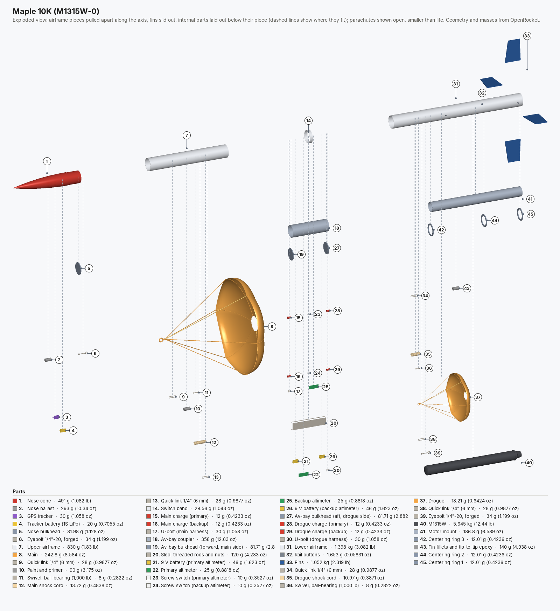

45 parts, each with OpenRocket's mass (the weighed values from the mass budget). The heaviest: M1315W (5.645 kg), Lower airframe (1.398 kg), Fins (1.052 kg). The parachutes open into canopies on their lines, and the connectors from step 12 hang where they go. Ask for `cutaway` to see everything in place instead.

### 29. "Animate the flight for our social media post."

<sub>Tools Claude uses: `animate_flight`</sub>

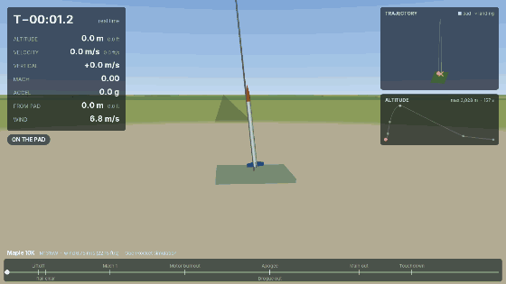

A 19.8 s loop (GIF; an MP4 too when ffmpeg is installed), and a sheet of stills that Claude shows in the chat:

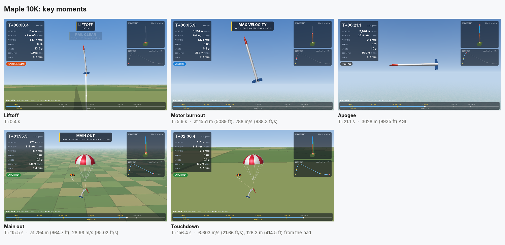

Real time through the burn, slowed down around apogee and each deployment; the coast and the long descent are sped up, with the rate on screen. Events on the timeline:

| Event | Flight time | In the video |
|---|---|---|
| Liftoff | 0.06 s | 1.3 s |
| Rail clear | 0.349 s | 1.6 s |
| Mach 1 | 2.926 s | 4.1 s |
| Max velocity | 4.037 s | 5.2 s |
| Motor burnout | 5.949 s | 7.2 s |
| Apogee | 21.07 s | 10.6 s |
| Drogue out | 21.08 s | 10.6 s |
| Main out | 113.7 s | 14.2 s |
| Touchdown | 157.4 s | 16.3 s |

### 30. "We're also flying a two-stage rocket. Simulate the staging, show it pulled apart and animate it."

<sub>Tools Claude uses: `run_simulation`, `render_3d`, `animate_flight`</sub>

> The sustainer lights at 1.535 s, 62.83 m up at 67.42 m/s and 4.759 deg off vertical (thrust-to-weight 10.27); apogee 674.9 m.
> - Sustainer: lands 36.18 m from the pad at 6.356 m/s.
> - Booster: lands 32.44 m from the pad at 8.448 m/s.

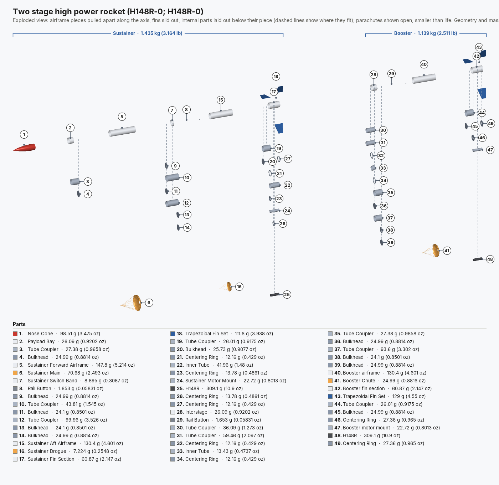

Each stage is followed through the whole flight. The captions name the stage (booster burnout, booster separation, sustainer ignition, sustainer burnout). A booster camera in the lower left follows the dropped booster down under its own chute. The trajectory inset draws its path in orange, and the flight summary lists where each stage lands.

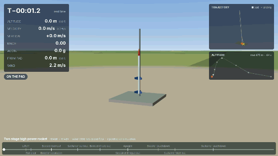

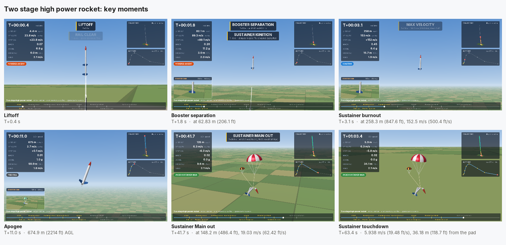

## After the flight

*"Here is our altimeter file — how did we do compared with the prediction?"* Claude lines the log up with the simulation (`compare_flight`), fits the drag so the next prediction is closer, and plots simulated against measured altitude.

## Team history

### 31. "Here's our folder of past rockets and flight logs. Which 4 in rockets have we flown, and how good were our apogee predictions over the years?"

<sub>Tools Claude uses: `design_library`</sub>

> 4 designs (2023-2026), 2 flight logs. 3 of them are 4 in rockets:

| Rocket | File | Year | Motors | Predicted apogee |
|---|---|---|---|---|
| Maple 10K | 2026/maple/maple-10k.ork | 2026 | M1315W (M, 6645 Ns (1494 lbf-s)) | 3028 m (9935 ft) (simulated now ('Simulation of [L1250DM-P]')) |
| Maple 10K | 2025/maple-pdr/maple-pdr.ork | 2025 | L1250DM (L, 4400 Ns (989.2 lbf-s)) | 3122 m (10243 ft) (simulated now in OpenRocket's default conditions (no simulation in the file)) |
| Two stage high power rocket | 2024/two-stage.ork | 2024 | H148R, H148R (I, 430.4 Ns (96.75 lbf-s)) | 675 m (2214 ft) (saved result of 'Simulation 1') |

Each altimeter log is matched to its design by name or folder:

| Year | Rocket | Predicted | Measured | Error |
|---|---|---|---|---|
| 2023 | Dual parachute deployment | 897.5 m (2944 ft) | 790 m (2592 ft) | +13.6% |
| 2024 | Two stage high power rocket | 675 m (2214 ft) | 609.9 m (2001 ft) | +10.67% |

> Overall, predictions over-estimated apogee by 12.13% on average over 2 flights (scatter 2.071%). Scale this year's predicted apogee by 0.8918 for a first estimate, and calibrate the drag with compare_flight on the closest past rocket's log.

<sub>(The two flight logs are samples made for this page; point Claude at your own folder of `.ork` / `.rkt` files and altimeter CSVs.)</sub>

Ask for `similarTo` to find the past rocket closest to the one you are designing, then open it to reuse its parts.

## Electronics

### 32. "Will our flight computer's sensors cope with this flight, and what do we set the altimeters to?"

<sub>Tools Claude uses: `sensor_check`, `altimeter_settings`</sub>

> 0 fail, 3 warn, 8 ok. Against the team's sensors (typical student parts, set in the standards):

| Sensor | Checked | Flight peak | Use of range |  |
|---|---|---|---|---|
| Accelerometer, ±16 g | axial acceleration (x), boost and coast | 15.2 g at t=0.815 s (boost) | 94.99% of range | WARN |
| Accelerometer, ±16 g | lateral acceleration (y, z) | 0.7378 g at t=1.76 s (boost) | 4.611% of range | PASS |
| Accelerometer, ±16 g | parachute openings | 17.17 g at t=113.7 s | 107.3% of range | WARN |
| High-g accelerometer, ±200 g | axial acceleration (x), boost and coast | 15.2 g at t=0.815 s (boost) | 7.599% of range | PASS |
| High-g accelerometer, ±200 g | lateral acceleration (y, z) | 0.7378 g at t=1.76 s (boost) | 0.3689% of range | PASS |
| High-g accelerometer, ±200 g | parachute openings | 17.17 g at t=113.7 s | 8.584% of range | PASS |
| Gyroscope, ±2000 deg/s | roll rate (x) | 0.001119 deg/s at t=4.01 s | 5.595e-05% of range | PASS |
| Gyroscope, ±2000 deg/s | pitch / yaw rate (y, z) | 35.86 deg/s at t=0.58 s | 1.793% of range | PASS |
| Barometer, 30-125 kPa | pressure (lowest at apogee) | 68.22 kPa (9.894 psi) at t=21.03 s |  | PASS |
| Barometer, 30-125 kPa | static pressure above Mach 0.7 | t=1.875 to 6.965 s (max Mach 1.13) |  | WARN |
| GPS receiver | speed and altitude (export limits 515 m/s, 18 km) | 385.6 m/s (1265 ft/s), 3328 m (10919 ft) MSL |  | PASS |

The altimeter card:

| Parachute | Primary altimeter | Backup altimeter |
|---|---|---|
| Main | 304.8 m (1000 ft) AGL on the way down | 274.3 m (900 ft) AGL on the way down |
| Drogue | apogee | apogee + 1 s |

> Mach lockout: 8 s after launch (above Mach 0.7 until t=6.949 s, plus 1 s). Static ports: bay volume 129 in3: 4 ports of 0.142 in (3.6 mm) evenly around the switch band (same area as 1.3 x 1/4 in).

### 33. "Give us simulated sensor data to test our flight software."

<sub>Tools Claude uses: `sensor_data`</sub>

> 16538 rows x 22 columns at 100 Hz (165.4 s: 5 s on the pad first), plus the true event times in a separate file. A few rows:

|  | time_s | acc_x_g (±16 g) | acc_hi_x_g (±200 g) | baro_pressure_pa | truth_altitude_agl_m | truth_phase |
|---|---|---|---|---|---|---|
| on the pad | 1.0000 | 0.99150 | 0.83300 | 97831.12 | 0.00 | pad |
| boost | 6.0600 | 14.78350 | 14.79800 | 97068.68 | 67.88 | boost |
| burnout | 11.1500 | -4.75000 | -4.75300 | 81092.88 | 1605.40 | coast |
| apogee | 26.0700 | -0.05950 | -0.14700 | 68213.86 | 3028.12 | coast |
| under the main | 152.4000 | -1.03950 | -0.83300 | 97094.36 | 65.73 | descent |

The ±16 g part comes within 5% of clipping at motor start, so a hotter motor or vibration would saturate it; the ±200 g part keeps the boost on scale. Under the main both read about −1 g (the canopy holding the rocket). Columns follow the team's sensors in the standards; pass your own parts with `sensors`.

### 34. "Do our batteries last a two-hour pad wait, and will we hear the GPS tracker all the way down?"

<sub>Tools Claude uses: `power_budget`, `radio_link`</sub>

> 2 h on the pad + 2.623 min flight + 2 h until found. Each circuit against its battery (the team's parts, set in the standards):

| Circuit | Needs | Usable | Runs for |  |
|---|---|---|---|---|
| Primary altimeter (9 V alkaline) | 48.52 mAh (12 mA for 4.044 h) | 440 mAh usable (550 mAh x 0.8) | 36.67 h on the pad and after | PASS |
| Backup altimeter (2S LiPo 300 mAh) | 48.52 mAh (12 mA for 4.044 h) | 240 mAh usable (300 mAh x 0.8) | 20 h on the pad and after | PASS |
| GPS tracker (1S LiPo 500 mAh) | 363.9 mAh (90 mA for 4.044 h) | 400 mAh usable (500 mAh x 0.8) | 4.444 h on the pad and after | WARN |

E-match: 2.5 A through each e-match (1.6 ohm match, 1.7 ohm battery, 0.3 ohm wiring); the battery holds 4.75 V (from 9 V) while firing.

> Link: 915 MHz, 20 dBm, antennas 2.15 / 2.15 dBi, receiver -123 dBm, losses 3 dB: 144.3 dB to spend on the path.

| Flight | Farthest in flight | After landing |  |
|---|---|---|---|
| Sustainer | 3179 m (10430 ft) at t=21.72 s (3026 m (9928 ft) up): +42.58 dB margin | 126.3 m (414.5 ft) away on the ground: +46.26 dB margin | PASS |

Ground range: 1019 m (3342 ft) with 10 dB margin once landed (ground station antenna 2 m (6.562 ft) up, rocket antenna 0.1 m (0.3281 ft) off the ground). In the air the path is clear, so free-space loss rules; on the ground the two antennas are near the earth and the signal falls off with the fourth power of distance, which is why a tracker heard at apogee can go quiet once it lands.

## Parachutes and product links

### 35. "Plot our main's size against descent rate for Cd 0.85, 1.5 and 2.2."

<sub>Tools Claude uses: `parachute_sizes`</sub>

> 8.218 kg (18.12 lb) (simulated mass under Main (Sustainer)); the drogue stays attached under the main, so 0.209 m2 of drag is counted (calibrated from the simulation). Target 6.096 m/s, below 9.144 m/s (30 ft/s) (R4.3.1).

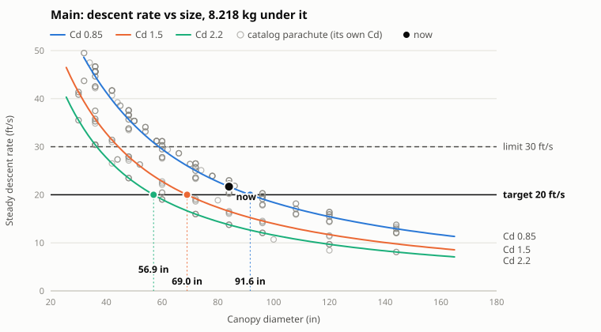

| Cd | Size for the target |
|---|---|
| 0.85 | 2327 mm (91.6 in) |
| 1.5 | 1751 mm (68.95 in) |
| 2.2 | 1446 mm (56.93 in) |

Catalog parachutes closest to the target (each at its own Cd):

| Parachute | Diameter | Cd | Rate |
|---|---|---|---|
| Rocketman PA-07 | 2134 mm (84 in) | 0.99 | 6.156 m/s (20.2 ft/s) |
| Rocketman HX-096 | 2438 mm (96 in) | 0.75 | 6.187 m/s (20.3 ft/s) |
| Spherachutes HS-096-CL | 2438 mm (96 in) | 0.75 | 6.187 m/s (20.3 ft/s) |

`apply: true` with one Cd sets the main to that size (rounded up to a whole inch) and re-flies the rocket.

### 36. "Here's the chute we want to buy: put it in as our main."

<sub>Tools Claude uses: `add_from_link`</sub>

|  | Value (source) |
|---|---|
| diameter | 2134 mm (84 in) (page) |
| cd | 2.2 (catalog: Fruity Chutes IFC-084-S) |
| mass | 379.9 g (13.4 oz) (catalog: Fruity Chutes IFC-084-S) |
| packedDiameter | 99.06 mm (3.9 in) (catalog: Fruity Chutes IFC-084-S) |
| packedLength | 157.5 mm (6.2 in) (catalog: Fruity Chutes IFC-084-S) |

> Main -> Iris Ultra 84" Compact Parachute: descent rate 6.613 m/s (21.7 ft/s) -> 4.207 m/s (13.8 ft/s) (simulated). The page named the maker and the size; Cd, weight and packed size came from the matching catalog entry (Fruity Chutes IFC-084-S).

<sub>(The product text here is a sample written for this page. With a link, the server reads the shop's page itself; when a shop blocks that, paste the page's text.)</sub>

## Explore it in the chat

### 37. "Show us the rocket and its flight so we can click through it."

<sub>Tools Claude uses: `show_design`</sub>

> Apogee 3027 m; Max speed 383.2 m/s; Rail exit 39.09 m/s; Stability (ascent) 2.96–5.91 cal; Max accel. 138 m/s2; Drogue descent 29.57 m/s; Iris Ultra 84" Compact Parachute descent 4.207 m/s; Landing 135.8 m. Rule checks: No failures; 6 warning(s).

In Claude Desktop and claude.ai the view opens in the chat. Anywhere else, open the HTML file it writes: [this one](examples/maple-10k-view.html) is the Maple 10K (download it and open it in a browser; it needs no internet).

- **Rocket:** drag to turn it, scroll to zoom. *Cut-away* opens the airframe, *Exploded* pulls the sections apart, *Side* is a view to scale with a ruler. CG and CP move as you scrub through the flight. Click a part to see its properties; in Claude, click a value to change it (the flight is re-simulated, and `undo` takes it back).
- **Fly:** replays the simulated flight in 3-D with the parachutes, following the rocket or the whole trajectory.
- **Flight plots:** altitude, speed, acceleration, Mach, stability, thrust and drag, angle of attack and mass, with the events marked and one time cursor across all of them (drag to zoom).
- **Trajectory** and **Rule checks:** the profile and ground track with the wind, and every check with its rule reference (in Claude, *Ask Claude how to fix* on a failure).

<p> </p>
<p> </p>

<sub>(Screenshots by [`scripts/view_shots.mjs`](../scripts/view_shots.mjs), which also checks the view in a headless browser.)</sub>
